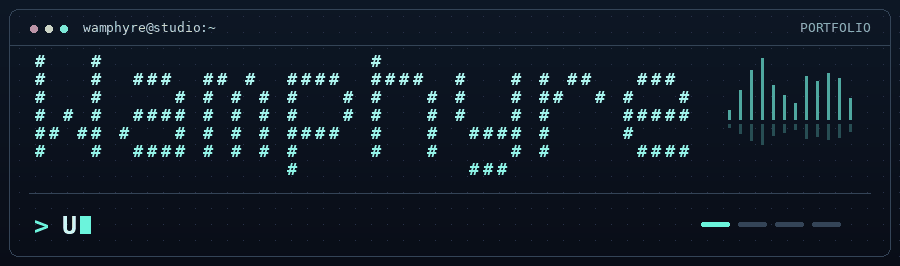

# Hi, I’m Wamphyre

I’m a Unix sysadmin and software developer with **10 years of experience**. I build open-source tools for FreeBSD, Linux, and macOS, develop audio software in C++, and make pixel-art games as **Wamphyre Studio**. I’m also a black metal musician.

## Retro games

[**Wamphyre Studio on itch.io**](https://wamphyre.itch.io/) is my solo studio for pixel-art games inspired by 16-bit consoles, dark fantasy, and horror.

- [**El Huésped**](https://wamphyre.itch.io/el-huesped) is a horror adventure for the Sega Mega Drive set in an abandoned clinic.
- [**Monster Chess**](https://wamphyre.itch.io/monster-chess) is a supernatural chess game with branching endings.

### YmirPS5

[**YmirPS5**](https://github.com/Wamphyre/YmirPS5) is my PlayStation 5 port of the [Ymir Sega Saturn emulator](https://github.com/ymir-emu/Ymir). It brings Saturn emulation to PS5 with a DualSense interface, Vulkan rendering, and support for original Saturn CDs via USB optical drives.

## Building software with AI agents

I use AI coding agents to prototype and build applications, software tools, and games. I’m good at turning a rough idea into clear direction for an agent, using examples and focused feedback to refine each iteration. I bring my own creative judgment to the result, from how the code is structured to how the interface looks and feels.

## Audio software and Unix systems

| Project | What it does |
| --- | --- |
| [**oXygen**](https://github.com/Wamphyre/oXygen) | C++ and JUCE mastering suite with an automatic mastering assistant, reference matching, and DSP regression tests. |
| [**BeastNgine**](https://github.com/Wamphyre/BeastNgine) | FreeBSD web-stack automation for Nginx, Varnish, PHP-FPM, and Valkey. |
| [**DrumCraker**](https://github.com/Wamphyre/DrumCraker) | Drum sampler with DrumGizmo kit support, multichannel routing, and MIDI humanization. |

